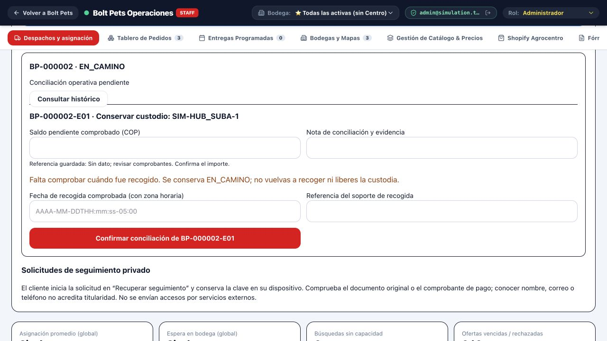
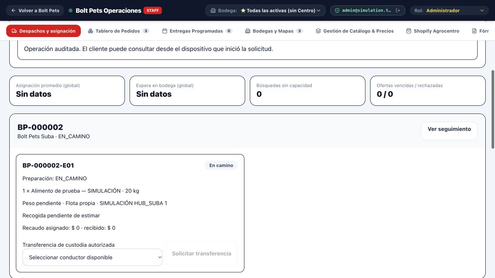
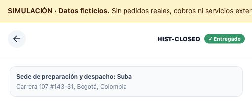
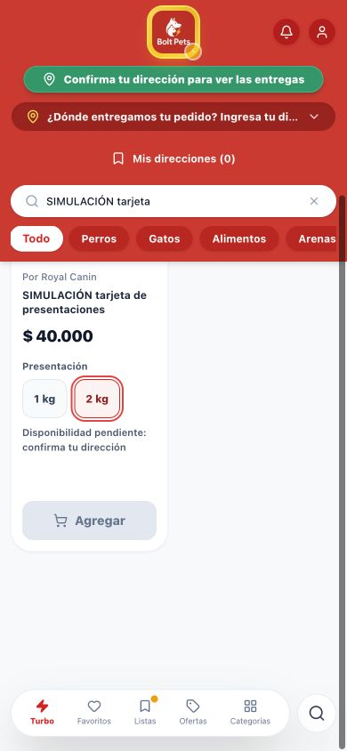
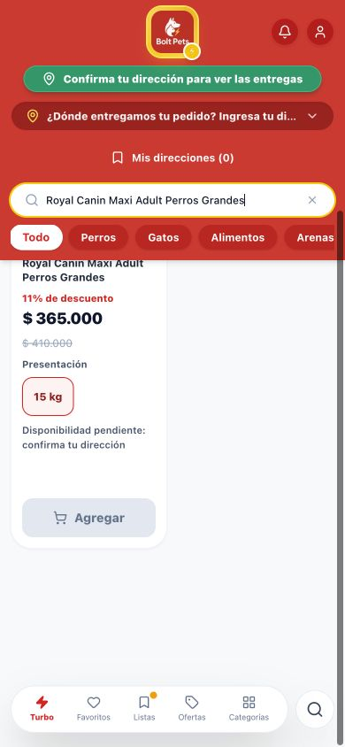

# Integración revisable de #9 y #10

Esta rama se origina en main f4fba7c y conserva sus cuatro archivos del PR #11 por hash Git. Incorpora #9 mediante un merge con dos padres. Los borradores originales no se modifican ni se cierran. La recuperación compatible indicada más abajo es el commit de correcciones del #9 de esta rama, antes del merge de fotografías #10; su SHA es `ba71174c6330515f9d2d3f6dc0c36214e3e780c8`.

## Históricos en administración

Administración → Despachos → Pedidos anteriores y recuperación de seguimiento lista también las compras sin run. Se puede buscar por código/estado. `PENDIENTE_CONFIRMACION` debe confirmarse en el flujo existente; nunca se activa un despacho por registrar un pedido sin confirmar. Entregados/cancelados quedan en lectura, sin reapertura.

Registrar usa `POST /api/v1/admin/dispatch/orders/:orderId/register`. Crea únicamente relaciones estables de despacho en incidencia y conserva la compra, existencias, reservas, cantidades, importe, estado, fechas e historial. Repetir no duplica códigos ni eventos de registro. El 409 de asignación permanece mientras falta registro/conciliación.

Cada despacho por conciliar muestra custodio, datos pendientes y saldo de referencia; un operador verifica y escribe el saldo pendiente y la evidencia. `POST /api/v1/admin/dispatch/:id/reconcile-legacy` registra actor, fecha de conciliación y huella del contenido. Repetir exactamente es idempotente; contenido diferente después de conciliar exige revisión. Preparación y búsqueda siguen el motor existente.

Si un histórico EN_CAMINO carece de pickedUpAt, se rechaza con PICKUP_EVIDENCE_REQUIRED antes de modificar conductor o despacho. El estado permanece en incidencia y la compra EN_CAMINO. Se admite evidencia alternativa de una **fecha histórica comprobada**, acompañada de referencia del soporte. Se conserva en legacyReconciliation.pickupEvidence y no se rellena silenciosamente el timestamp original. La fecha de intervención es distinta. Si solo se conoce que ocurrió la recogida, pero no existe fecha comprobable, continuar conciliación manual: no usar la hora actual ni liberar custodia. Falta de custodio, cuenta o capacidad verificadas sigue bloqueando.

## Recuperación privada de seguimiento

Cliente → Historial → Recuperar seguimiento, o `/recuperar-seguimiento`. El dispositivo genera una clave aleatoria de 256 bits; guarda su solicitud en `bolt_tracking_recovery_v1` y envía la clave solo en cuerpo HTTPS al backend de la misma app. No se usa en URL. El servidor conserva únicamente su hash, referencia, estado y vigencia de 24 horas. Iniciar no revela si una compra existe ni modifica el pedido.

- POST `/api/v1/tracking-recovery`: iniciar de manera idempotente.
- POST `/api/v1/tracking-recovery/status`: requiere ID y clave privada de esa solicitud; únicamente después de aprobación devuelve acceso a esa compra.
- GET `/api/v1/admin/dispatch/recoveries`: administrador autenticado; excluye secretos y hashes.
- POST `/api/v1/admin/dispatch/recoveries/:id/approve`: administrador autenticado, revisión explícita de titularidad, método y referencia `CASE-...` del expediente.

La prueba automática de propiedad solo reutiliza un acceso privado válido existente. Los pedidos antiguos sin ese acceso requieren revisión humana de comprobante original (la referencia debe coincidir con la transacción guardada) o documentos y compra revisados presencialmente. El backend delega esa verificación presencial al administrador autenticado y la audita; no hay OTP ni validación documental automatizada. No guardar documentos, nombres, teléfonos o secretos en el campo CASE. Conocer contacto o código de compra no autoriza el acceso.

La emisión usa la capacidad privada de pedido existente y no crea runs, ni reabre cerrados. Al consultar la autorización, el navegador guarda el token con el mecanismo existente de api.ts. La auditoría contiene actor, pedido, caso, método y referencia, nunca la clave ni el token. No se activa mensajería externa; no enviar enlaces de acceso por servicios de terceros dentro de esta etapa.

## Verificación de bodega

backendAuthorization permite credenciales únicamente hacia rutas explícitas del backend del mismo origen, incluida `/api/v1/stores/:id/verify-entrance`. Sin sesión: 401; rol por cabecera: 401; token inválido o de conductor: 403; admin con coordenadas inválidas: 400; coordenadas estructuralmente aceptadas: 200. Guardarlas **no acredita presencia física** en la bodega.

## Transición por instalación

No copiar almacenamiento de pruebas ni ejecutar una migración masiva en producción desde esta revisión. Respaldar primero la instancia con un único escritor detenido. Identificar la carpeta de catálogo/precios/inventario por separado y el `BOLT_DATA_DIR` real.

Fuentes: hasta la transición se leen los archivos legacy existentes, o el snapshot unified v1 del #9. Después de publicar v2, **solo persisted-fulfillment.json v2 es autoritativo** para pedidos, conductores, estados de despacho, accesos, telemetría y auditoría. Catálogo/precios/reservas siguen sus repositorios existentes; la transición no los sustituye.

Desde la revisión compatible, con dependencias instaladas y el servidor detenido:

```
node --import tsx scripts/fulfillment-storage.ts check /ruta/absoluta/datos /ruta/revision-compatible
node --import tsx scripts/fulfillment-storage.ts migrate /ruta/absoluta/datos /ruta/revision-compatible
node --import tsx scripts/fulfillment-storage.ts backup /ruta/absoluta/datos /ruta/revision-compatible
npm run build
node --import tsx scripts/fulfillment-storage.ts run /ruta/absoluta/datos /ruta/revision-compatible
```

El primer cambio operativo también usa este mismo mecanismo si aún no se ejecutó migrate; el arranque de lectura no registra pedidos ni reasigna conductores. La herramienta utiliza un bloqueo por carpeta de datos; el servidor mantiene además su bloqueo de catálogo.

Proceso versionado: copia recuperable de las fuentes en `.bolt-storage/backups/<id>/`; hashes de origen; journal PREPARED; fsync y rename de un único snapshot v2; journal COMMITTED. El journal es comprobación recuperable, no otra copia autoritativa. No se declaran atómicas escrituras independientes. Antes de publicar, una interrupción conserva las fuentes; al reanudar se exige que sus hashes coincidan. Después de publicar, v2 prevalece incluso si faltó marcar COMMITTED; la próxima escritura completa ese registro. Cambio de las fuentes durante la transición se bloquea para revisión. Se conserva la transición original y revisión creciente en cada snapshot. Los backups son privados.

## Reversión compatible (no basta con Git)

No iniciar f4fba7c ni los borradores antiguos contra una instalación ya transicionada. Su código no conoce v2 y puede leer archivos legacy obsoletos. Los archivos legacy se conservan como evidencia; no son proyecciones ni reciben escrituras paralelas.

1. Detener el escritor y crear un respaldo **actual** con `backup`, sin restaurar datos antiguos.
2. Seleccionar el commit de correcciones #9 de esta rama (antes de fotografías) u otra revisión que declare y pruebe `storage-contract.json` v2.
3. Desde la herramienta compatible ejecutar `check DATA_DIR CANDIDATE_DIR`. Rechaza main anterior sin contrato **antes de arrancarlo**. Compilar el candidato compatible y ejecutar `run DATA_DIR CANDIDATE_DIR`.
4. Mantener el mismo archivo v2 y el resto del almacenamiento comercial actual. Verificar códigos, entregas, recaudos, auditorías y reservas posteriores. No importar el backup de origen sobre movimientos nuevos.

El guardado/arranque gestionado detecta lectores incompatibles. No puede impedir que un operador ejecute directamente un binario antiguo ignorando este procedimiento. `server.js` antiguo, npm start antiguo y restauraciones manuales no son una reversión soportada. El contrato declara compatibilidad de código confiable revisado; no valida software arbitrario.

La revisión de recuperación mantiene el backend corregido y todos los estados nuevos; permite revertir las fotografías sin perder entregas posteriores. No hay conversión prometida al esquema anterior. Un retorno total a software anterior requeriría un proyecto separado de conversión validada. Se mantiene un proceso escritor; varias réplicas requieren almacenamiento transaccional compartido.

## Regresiones

storageTransition.test.ts comprueba interrupciones antes/después de publicación, reanudación, conflicto de fuente, conservación de movimientos posteriores y rechazo de lectores incompatibles. historicalIntegrationHttp.test.ts prueba nueve estados con HTTP real aislado, autorización por rol, recuperación abierta/cerrada, evidencia de custodia, reintentos, secretos ausentes de listados/auditoría, inventario y reinicio. Los cuatro archivos #11 se conservan; nuevas pruebas van en archivos independientes. Las pruebas de imágenes se incorporan al comando general al integrar #10.

Para ejecutar en el entorno restringido puede usarse `node --import tsx src/tests/<suite>` en vez del lanzador tsx. La evidencia del PR distingue tests de componentes del recorrido real en navegador.

## Evidencia final de esta integración — 8 de noviembre de 2026

Referencias verificadas nuevamente: main `f4fba7c9a1c4539c279bf480c50dd18a3c6dae3a`, #9 `0c0df85da521bfb3fa5594cb2a58828a4f78de11`, #10 `eb91d86759b7df6a88750430331b980842df0e3d`. No cambiaron durante el trabajo. Rama: `codex/integracion-segura-20261108`. La integración tiene merges con los originales como padres; no se sustituyó main por el árbol de otra rama.

### Causas y correcciones

| Problema | Causa | Corrección |
| --- | --- | --- |
| Históricos invisibles / 409 sin recorrido | El panel recorría runs, mientras los históricos solo existían en OrdersRepository; los endpoints no tenían formularios | historicalOrders y HistoricalOperations muestran todos los estados, permiten registro y conciliación con auditoría. El 409 protege pendientes reales. |
| EN_CAMINO sin pickedUpAt | reconcileLegacy elegía ASSIGNED si faltaba el timestamp, aunque el histórico estaba en camino | Validación anterior a cualquier mutación; conserva incidencia y EN_CAMINO. Evidencia alternativa con fecha y soporte permite PICKED_UP; no se inventa la fecha original. |
| Seguimiento histórico bloqueado | No existía capacidad privada para algunos pedidos anteriores, incluidos cerrados | Solicitud opaca con clave local y hash servidor; aprobación administrativa con evidencia; emisión mediante la capacidad existente sin registrar despachos. |
| verifyStoreEntrance 401 | La llamada usaba fetch sin la sesión de las operaciones administrativas | authorizedFetch con lista explícita de rutas y mismo origen; autenticación separada de validación de coordenadas. |
| Reversión con estados divergentes | #9 persistía fulfillment mientras código anterior leía archivos legacy | Snapshot autoritativo v2, backup/journal recuperable, lector compatible y comprobación previa al arranque. Legacy es solo evidencia. |
| Métrica negativa encontrada en navegador | Asignación histórica anterior a la fecha de registro en el motor nuevo | Excluir intervalos históricos no medidos del promedio; conservar totales operativos. No se convierten en cero ficticio. |

### Comprobaciones ejecutadas

- TypeScript, compilación y las **22 suites** del comando test: correctas. Detalle en [suites.json](review-evidence/suites.json).
- Después del hallazgo visual: TypeScript, rebuild y regresiones HTTP de históricos, 19 casos de despachos, almacenamiento e imágenes ejecutadas de nuevo; correctas. El cliente real `api.applyCatalogImages` envía sesión y aplica un parche de prueba por el endpoint protegido.
- Nueve estados históricos aislados: pendiente de confirmar, confirmado, alistamiento, listo, en camino con/sin fecha y sin custodio, entregado y cancelado. Registro/conciliación, intentos inválidos, replay, recuperación asistida de todos ellos, reinicio y conservación comercial comprobados por HTTP.
- Auth bodega: 401 sin sesión y cabecera de rol; 403 token inválido y conductor; 400 administrador con coordenadas nulas; 200 administrador con coordenadas del fixture. No prueba presencia física.
- Imágenes: rechazo de campos comerciales y conflictos, idempotencia, fotografía de variante, carga alternativa, categorías y carga progresiva, auditoría y reinicio. No se aplicó el lote de 536 productos en instalaciones operativas.
- Reversión **entre servidores compilados** en una copia ficticia: completar una entrega con código nuevo, detenerlo, rechazar main antiguo, iniciar el servidor del commit ba71174 con almacenamiento actual. Pedido y despacho ENTREGADO/DELIVERED, códigos, cantidades, importes, auditoría, recuperación y catálogo preservados. El launcher transmite SIGTERM al proceso hijo. [Resultado](review-evidence/rollback.json).

### Navegador real, datos ficticios

En el entorno aislado de revisión se hizo registro → conciliación de saldo → oferta al conductor elegible para HIST-READY; para HIST-WAY se vio el dato de recogida pendiente, se aportó una fecha histórica de fixture con referencia y se obtuvo PICKED_UP/EN_CAMINO con el custodio original. Al reiniciar se conservaron ambos códigos y estados.

Para HIST-CLOSED se solicitó recuperación desde cliente, se aprobó con evidencia ficticia explícita desde administración, se cerró la sesión administrativa y se abrió seguimiento en la ruta de invitado. Continuó ENTREGADO sin nuevo despacho. La capacidad privada sobrevivió al reinicio; la sesión administrativa requirió volver a autenticarse.

Tarjetas revisadas a 1280×720 y 390×844: variante de fixture 1 kg/$25.000 → 2 kg/$40.000, precio principal actualizado; chips sin precio; presentación única 15 kg seleccionada. En móvil el ancho del documento fue 390 px, sin desbordamiento horizontal. El botón de compra permaneció bloqueado con dirección pendiente. La correspondencia selección/carrito/checkout se comprobó mediante las suites existentes; no se creó un pedido de catálogo desde ese navegador.







### Reproducir en otra copia aislada

Desde el checkout de revisión, instalar dependencias y compilar. Crear una carpeta nueva (el generador rechaza una existente):

```
node --import tsx src/tests/createIntegrationReview.ts ../bolt-dispatch-simulation-integracion
BOLT_DISPATCH_SIMULATION=1 NODE_ENV=production PORT=3042 node --import tsx scripts/fulfillment-storage.ts run ../bolt-dispatch-simulation-integracion/.bolt-private/orders ../bolt-dispatch-simulation-integracion
```

Abrir `http://127.0.0.1:3042/simulacion`, ingresar a la simulación y abrir Administración → Despachos. Credenciales ficticias generadas quedan privadas en la copia. No copiar sus archivos persisted, credenciales o configuración de flota a una instalación real.

### Pendientes y decisiones humanas

- Verificar titularidad de históricos sin capacidad previa; cotejar comprobantes/documentos mediante administración autorizada. Los datos de contacto conocidos no bastan.
- Resolver custodia, fecha histórica de recogida, cuentas de conductor, saldo pendiente y capacidades cuando falte evidencia. Sin fecha comprobable, EN_CAMINO sigue pendiente; no asignar una recogida nueva.
- Configurar flota, rutas y disponibilidad reales. Rappi e inDrive siguen desactivados; la simulación no demuestra disponibilidad de producción.
- Aplicar transición por instalación con un escritor detenido, respaldo actual y aceptación operativa. No se migró ninguna instalación real en esta tarea.
- #10 integra código y un plan, no su aplicación automática. El informe original de fotografías registra 1.413 campos vacíos y 9.396 registros pendientes de verificación visual. Estas cifras son de su auditoría, no una nueva certificación de empaques. Revisar fuentes y posibles ediciones posteriores antes de cada lote. Véase [IMAGENES-CATALOGO.md](IMAGENES-CATALOGO.md).
- Reversión soportada a ba71174 mantiene el backend corregido. Incluye también la corrección de promedios históricos. No volver a main antiguo contra v2. Se conserva almacenamiento comercial, auth, uploads y configuración actuales **además** de BOLT_DATA_DIR.

### Archivos del PR #11 conservados sin cambios

| Archivo | SHA Git blob |
| --- | --- |
| src/components/customer/PresentationSelector.tsx | 31b407ba7ea8115db6270048eff3dabd494842a3 |
| src/lib/presentationDisplay.ts | e7999d2091eef2cb861132533faa445072fc4a67 |
| src/tests/catalogPurchase.test.tsx | 35d1d46113c3ebf6eea62dea92cdb494e434bdd8 |
| src/tests/presentationSelection.test.tsx | 6b5dca4c0dcc510175f8955ab7578be3107ceb41 |

Inventario de archivos: [INTEGRACION-ARCHIVOS.md](INTEGRACION-ARCHIVOS.md).
